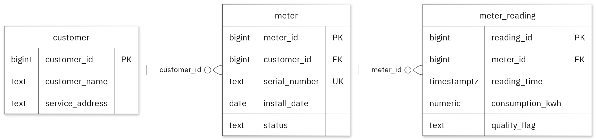

# MIT 8103 Advanced Database Systems

**Smart Meter Management and Electricity Consumption Monitoring System** · Toluwaleke Matilukuro · Student ID 301906386

## Case study

My case study is Smart Meter Management and Electricity Consumption Monitoring System. I designed the database for utility operations staff, energy analysts and database students, with separate tables named customer, meter and meter_reading. It supports these operations: register a customer and associate meters with that customer; record meter readings with timestamps, consumption, and a quality flag; review readings for a meter over a selected time range; benchmark a time-range reading query on 50000 synthetic readings by comparing plans and elapsed time before and after the proposed B-tree index on reading_time; record observations without assuming a performance result.

## Portfolio 1: Database Design and Modelling

I organized the relational design into 3 tables. Primary keys identify records, foreign keys preserve the links, and checks enforce the stated business rules. Recorded consumption in kWh must be greater than or equal to zero. The design entails three normalization stages:  ensuring non-key attributes depend on the whole primary key.First Normal Form(1NF) which ensures attributes contain atomic values and ensures repeating groups are eliminated, Second Normal Form (2NF) which requires non-key attributes to be dependent on the entire primary key, removing partial dependencies. The Third Normal Form (3NF) removes transitive dependencies  The normalization examples show the sample data at 1NF, 2NF and 3NF. All 9 deliberately invalid inserts were rejected without changing the valid sample rows.

Figure 1. Tables, keys and relationships. PK: primary key; FK: foreign key; UK: unique value.

<!-- PAGE BREAK -->

## Portfolio 2: Query Processing and Optimisation

I ran three SQL queries against the sample records. The join returned 2 rows and included SM-1001 with Avery Chen. For the index comparison, I used 50,000 separate performance rows. The B-tree index was introduced on reading_time to improve the retrieval of readings within a time range. The execution plans were reviewed to identify changes in the database access strategy before and after indexing. The median lookup time changed from 2.412 ms to 0.311 ms. Both phases returned the same records. The measured plan used the new index. These timings apply to this lookup and environment.

## Portfolio 3: Transactions and Concurrency

I used a temporary counter on meter_reading to test COMMIT, ROLLBACK and READ COMMITTED isolation. The uncommitted update remained hidden from the other session, and ROLLBACK restored the earlier committed value. Without locking, two increments left the counter at 2. With SELECT FOR UPDATE, Session B waited for Session A and the final value was 3. The helper is confined to this exercise; the case's original business fields stay unchanged. The concurrent update exercise demonstrated a lost update anomaly, which happens when one transaction overwrites another transaction's update because both operate on the same previously read value. Using SELECT FOR UPDATE provided a row-level lock before the update, restricting the second session from beginning until the first transaction completed.

## Portfolio 4: NoSQL and Advanced Data Models

I used meter_events for the case's event documents. MongoDB inserted 4 sample events and returned the expected results for 4 queries. Validation rejected an invalid date type and a duplicate event ID. Embedded snapshots keep related details with an event, while the details field can differ by event type. These are fictional events; PostgreSQL continues to enforce its relational rules.
MongoDB validation was used to enforce the document structure and data types, while uniqueness controls prevented duplicate event identifiers. These mechanisms demonstrate how document databases aid data integrity while maintaining flexibility in document attributes.

## Repository and evidence

https://github.com/toluwaleke-matilukuro/Matilukuro_Toluwaleke_301906386

The portfolio folders contain the SQL and JavaScript, explanations, query plans, result tables and screenshots.

<!-- PAGE BREAK -->

## Portfolio 5: Distributed and Cloud Database Exercise

I proposed three MongoDB replica members across separate failure zones. The discussion covers primary elections, majority acknowledgement, secondary lag and sharding trade-offs for meter_events. Replication supports availability, while backups address recovery. PostgreSQL needs its own availability plan. This is the permitted discussion option; no live replica set or failover test was deployed.

## Individual reflection

I kept customer, meter, meter_reading in separate tables so their details could be maintained without repeating them in every related record. Recorded consumption in kWh must be greater than or equal to zero. The constraint tests check this alongside the required values and record links. One issue illustrated by the two-session exercise is that both sessions can read the same value before either update is committed. Locking the row before reading preserves both increments. The index comparison also shows why I need to check the execution plan as well as the final answer: the same result can require different amounts of database work. This project increased my understanding of the effect of database design decisions on data integrity, performance and scalability. I understood that query optimization required reviewing execution plans instead of solely depending on query results. The concurrency exercise showed the importance of transaction isolation and locking in preventing inconsistent updates. This taught me that relational and document database architectures introduce extra considerations around consistency, availability and recovery.

## AI-use declaration

I used GitHub Copilot and the portfolio generator to support in the preparation of the database model, scripts and explanations. The generator ran the PostgreSQL and MongoDB exercises, checked their outputs and captured the result images.  I remain responsible for verifying, ensuring the accuracy of and explaining the submitted work.

## References

- [PostgreSQL: constraints](https://www.postgresql.org/docs/17/ddl-constraints.html)
- [PostgreSQL: EXPLAIN](https://www.postgresql.org/docs/17/using-explain.html)
- [PostgreSQL: isolation](https://www.postgresql.org/docs/17/transaction-iso.html)
- [PostgreSQL: row locks](https://www.postgresql.org/docs/17/explicit-locking.html)
- [MongoDB: data modelling](https://www.mongodb.com/docs/manual/data-modeling/)
- [MongoDB: replication](https://www.mongodb.com/docs/manual/replication/)
- [MongoDB: sharding](https://www.mongodb.com/docs/manual/sharding/)
- [Mermaid: ER diagrams](https://mermaid.js.org/syntax/entityRelationshipDiagram.html)

